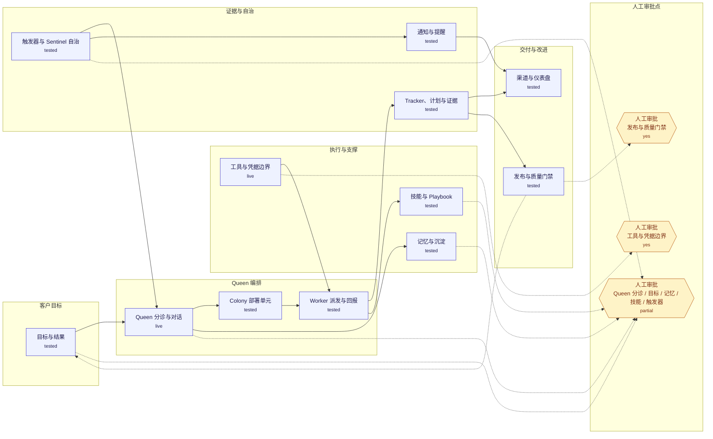
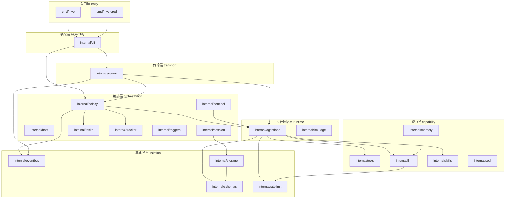
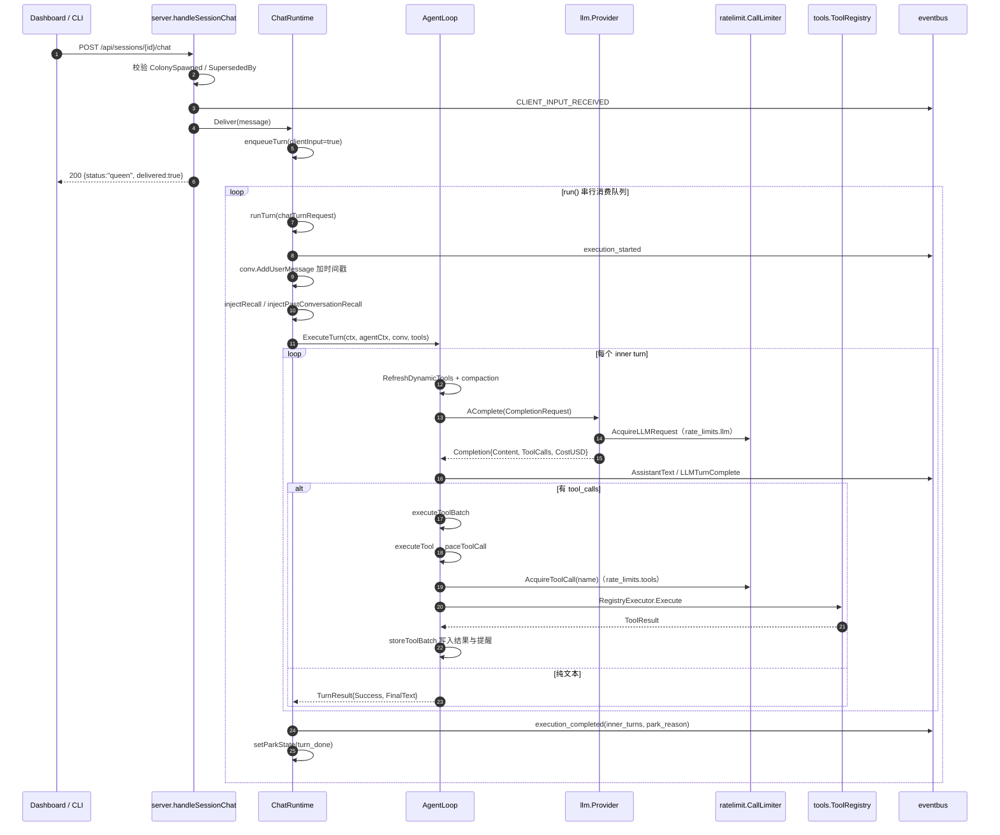
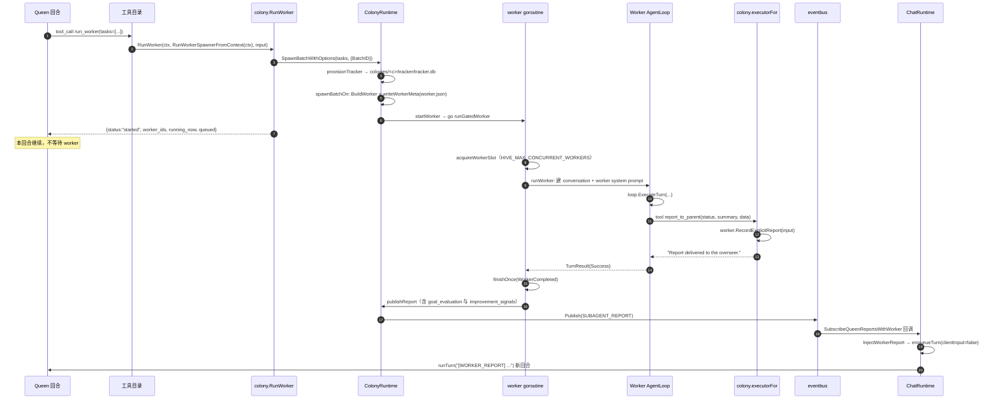
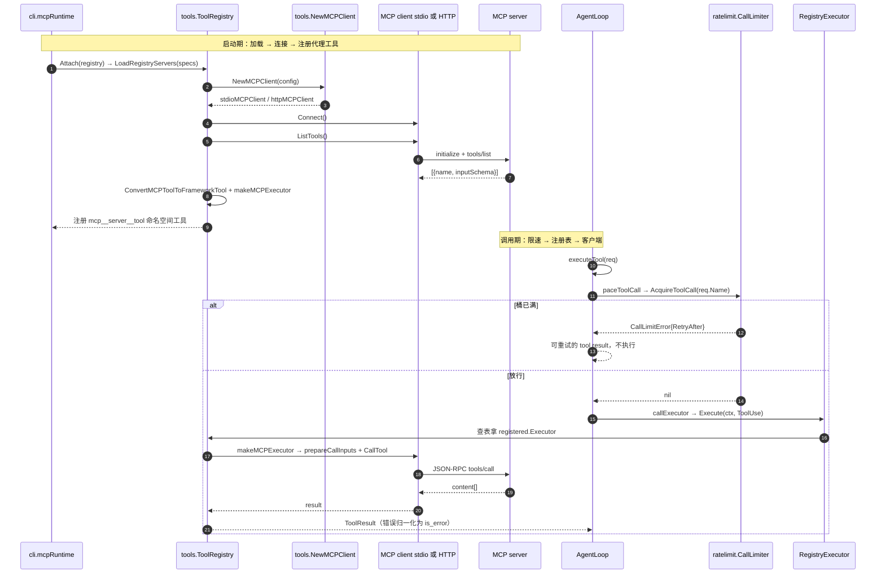

# go_hive 架构图：业务能力 + 技术分层

这套图回答两个不同的问题，用同一份模型生成：

- **业务视图（给人、给管理者）**：Hive 能为客户做成什么，从目标到交付经过哪些能力，人在哪些点必须签字或填表。
- **技术视图（给工程、给 AI agent）**：代码里有哪些包，谁依赖谁，哪一层在破规矩，改一处会牵动什么。

两份视图在 `capability-tech-crosswalk.md` 里对齐：每一条业务能力都落到具体的包、HTTP/CLI/工具入口和磁盘证据。图不是手绘的，源是 `architecture/model.yaml` + `go list`，改代码后重新生成即可。

> 正文里的路径相对 `go_hive/`；命令行示例假定在仓库根执行，所以带 `go_hive/` 前缀。

```text
architecture/model.yaml ──┐
                          ├─→ scripts/gen_arch.py ─→ graph.json（机器读）
go list -json ./...  ─────┘                       └─→ 4 张图/表（人读）
```

## 目录

| 文件 | 谁读 | 说明 |
| --- | --- | --- |
| `architecture/model.yaml` | 维护者 | **唯一手写源**：层、包职责、12 条业务能力、业务主链路 |
| `architecture/graph.json` | AI agent / 工具 | 业务 + 技术的机器可读图（节点、边、能力、warnings） |
| `docs/architecture/capability-map.mmd` | 人 | 业务能力关系图，标注人工审批点 |
| `docs/architecture/capability-tech-crosswalk.md` | 人 + agent | 业务能力 ↔ 模块 ↔ 入口 ↔ 落盘证据 ↔ 成熟度 |
| `docs/architecture/dependency-map.mmd` | 人 | Mermaid 分层依赖图 |
| `docs/architecture/dependency-map.dot` | 人 | Graphviz 版本，便于导出大图 |
| `docs/architecture/MODULES.md` | 人 | 44 个包的模块表与分层检查结果 |

> `capability-map.mmd`、`dependency-map.*`、`MODULES.md`、`capability-tech-crosswalk.md`、`graph.json` 都是生成物。改分层或能力请改 `model.yaml`，不要手改生成物。

---

# 一、业务视图：能力地图



（完整的逐能力审批节点见 `capability-map.mmd`；上图把 `partial` 合并成一个节点以免拥挤。）

## 怎么读这张图

1. **横向是交付链路**：客户目标 → Queen 编排 → 执行与支撑 → 证据与自治 → 交付与改进。箭头表示"下一个能力会消费上一个的产出"，不是函数调用。
2. **实线是主链路，虚线是反馈或审批**：`release-quality -.-> goal-outcome` 表示一次交付的结论会变成下一轮目标；能力指向六边形的虚线表示该能力有人工审批点。
3. **节点里的 tested/live 是成熟度**：`live` 有端到端测试证据，`tested` 有单元/集成测试与真实入口但没有端到端证据，`unverified` 表示未接线。口径见 `capability-tech-crosswalk.md`。
4. **六边形不是装饰**：`yes` 表示关键动作必须由人完成；`partial` 表示默认路径自动，但缺凭据、`ask_user`、soul 提案 review、Sentinel escalate 会停下来等人。

## 12 条能力一览

按主链路顺序排列；细节（模块、入口、落盘、限制）在 `capability-tech-crosswalk.md`。

| # | 能力 | 一句话结果 | 人工审批 | 成熟度 |
| ---: | --- | --- | :---: | :---: |
| 1 | 目标与结果 | 一句话目标 → 加权成功标准 → 验收判定 | partial | tested |
| 2 | Queen 分诊与对话 | 消息被理解、追问或派工，并流式回放 | partial | live |
| 3 | Colony 部署单元 | 一目标一 colony，可暂停、可恢复 | no | tested |
| 4 | Worker 派发与回报 | `run_worker` 一次提交 N 个任务，后台回报 | no | tested |
| 5 | Tracker、计划与证据 | 每行结果可追溯，计划跨回合存活 | no | tested |
| 6 | 记忆与沉淀 | 跨会话记忆；soul 可审阅、可回滚 | partial | tested |
| 7 | 技能与 Playbook | 可复用流程固化成技能与批量动作 | partial | tested |
| 8 | 触发器与 Sentinel 自治 | 定时唤醒；停泊期决定推/升级/不动 | partial | tested |
| 9 | 工具与凭据边界 | 工具按 tier 可见，凭据在边界内注入 | yes | live |
| 10 | 渠道与仪表盘 | Dashboard / CLI / 渠道看到同一会话 | no | tested |
| 11 | 通知与提醒 | 到点提醒与升级送到人，且有发送记录 | no | tested |
| 12 | 发布与质量门禁 | 七门禁 + 漂移检查 + 发布清单可复现 | yes | tested |

---

# 二、三条端到端叙事

每条都给出：业务上发生了什么 → 经过哪些模块 → 留下什么磁盘证据。图上的能力名对应上一节。

## 2.1 客户目标 → 交付

1. 客户在 Dashboard 输入目标，`POST /api/sessions/{session_id}/chat`。`server.handleSessionChat` 校验会话未被 colony 锁定，把消息交给 `ChatRuntime.Deliver`，立即返回 `{status:"queen"}`。
2. `ChatRuntime.run` 串行取出 turn，`runTurn` 写入带时间戳的用户消息、注入记忆召回，然后调用 `AgentLoop.ExecuteTurn`。
3. 首次派工前必须先有 colony 目录：`POST /api/colonies/{colony_id}/scaffold` 写 `metadata.json`、`worker.json`（含 goal）并建 `skills/`、`runs/`、`triggers.json`；会话再用 `POST /api/sessions/{session_id}/colony` 绑定它。随后 Queen 调用 `run_worker` 工具 → `colony.RunWorker` → `ColonyRuntime.SpawnBatchWithOptions`，任务在后台启动，工具立即返回 `worker_ids`。
4. 每个 worker 在自己的 goroutine 里跑 `runWorker`：独立系统提示、独立 `tasks.json`、共享 colony 的 `tracker/tracker.db`。它用 `tracker_upsert` 写证据，结束时 `report_to_parent`。
5. `publishReport` 把报告发布成 `SUBAGENT_REPORT`，`ChatRuntime` 的订阅把它变成一条 `[WORKER_REPORT]` 用户回合，Queen 在自己的会话里看到结果并汇总。
6. 汇总结果通过 SSE 回放给 Dashboard；需要打包时走 `POST /api/sessions/{session_id}/report-bundle`。

**经过的模块**：`internal/server` → `internal/agentloop` → `internal/tools` → `internal/colony` → `internal/tracker` → `internal/eventbus` → `internal/server`。

**落盘证据**：
- `~/.hive/queens/<queen>/sessions/<session>/`：消息 parts 与 `cursor.json`
- `~/.hive/colonies/<colony>/worker.json`：`goal` 与 `success_criteria`
- `~/.hive/colonies/<colony>/metadata.json`：colony 名称、queen 绑定与来源会话
- `~/.hive/colonies/<colony>/tracker/tracker.db`：worker 写入的结果行
- `~/.hive/colonies/<colony>/workers/<worker_id>/`：worker 的 `worker.json` 与 transcript

## 2.2 失败 → 改进信号

1. worker 的 turn 结束时，`evaluateWorkerGoal` 用目标里的加权标准验收最终输出（`agentloop.EvaluateGoal`）。
2. 未通过的 criterion 变成 `improvement_signal`（`unmet_criterion`）；judge 的 RETRY/ESCALATE 由 `OnJudgeVerdict` 记成 `judge_retry`；注册了却没有行的 tracker 表记成 `empty_tracker`。
3. 信号追加到 `~/.hive/colonies/<colony>/improvement/signals.jsonl`，同时在事件总线上发一条 `custom kind=improvement_signal`，并随 `publishReport` 进入 `[WORKER_REPORT]` 的 payload。
4. Queen（或人）据此决定重新派工、修改技能/playbook，还是接受现状。决策本身不自动执行 —— 这是设计上的"停下来看一眼"。

**经过的模块**：`internal/colony`（`goal_outcome.go`、`improvement.go`）→ `internal/agentloop`（judge）→ `internal/eventbus` → `internal/server`。

**落盘证据**：`improvement/signals.jsonl`、worker 终止状态（`worker.json`）、报告里的 `goal_evaluation` 与 `improvement_signals`。

## 2.3 触发器唤醒 → 报告

1. `POST /api/sessions/{session_id}/triggers` 创建触发器，`triggers.SaveTriggerToAgent` 写入 `<session>/triggers.json`。
2. `server.StartTriggerTimer` 起一个进程内 timer，`runTimerLoop` 用 `triggers.NextDueFrom` / `NextCronMatch` 计算下一次到期。
3. 到点 `EmitTriggerFired` 发事件，`injectTrigger` 调 `ChatRuntime.InjectTrigger`，把 trigger 作为带自身时间戳的回合入队；Queen 像处理用户消息一样处理它。
4. Queen 可以再 `run_worker`，于是接回 2.1 的报告回路；worker 完成时 `[WORKER_REPORT]` 回到 Queen。
5. 如果 Queen 已经停泊而目标未完成，`sentinel` 判定 nudge / escalate / do-nothing。escalate 写入 `~/.hive/colonies/<colony>/notifications.json` 与 `escalations/`，经外部渠道找人；人的回复由 Sentinel 路由回停泊的 Queen。

**经过的模块**：`internal/triggers` → `internal/server`（`trigger_runtime.go`）→ `internal/agentloop` → `internal/colony` → `internal/sentinel` → `internal/eventbus`。

**落盘证据**：`triggers.json`、`notifications.json`、`escalations/`、worker 报告。

---

# 三、技术视图：分层依赖



## 怎么读这张图

- **箭头 A --> B 读作 "A imports B"，依赖指向下方**。一个小箭头就是一次编译期依赖；改 B 的导出标识符会波及 A。
- **层是严格有序的**：`entry(0) → assembly(1) → transport(2) → orchestration(3) → runtime(4) → capability(5) → foundation(6)`。生成器会检查每条 import 边，从深层指向浅层就写进 `warnings`。
- **同层依赖是允许的**（例如 `colony → tracker`）：它们是一组协作的编排组件，不是分层违规。
- **入度高的包是改动放大器**：`internal/hivehome`（15 个包依赖）、`internal/eventbus`、`internal/schemas`、`internal/agentloop` 改一次要考虑的面很大。具体数字在 `MODULES.md`。
- **当前分层检查结果**：124 条 import 边，0 条反向依赖；2 个包没有内部导入方（`internal/charts`、`internal/orchestrator`，均为未接线代码）。`internal/quality` 是纯门禁包，按约定不计入未接线。

层定义、每包职责、依赖/被依赖计数与入口标记，全部在 [`MODULES.md`](./MODULES.md)。

---

# 四、三张关键序列图

序列图是手工维护的"代码路径证据"，不是生成物；如果重构改了这些函数名或调用顺序，请在同一个 PR 里更新它们。

## 4.1 一次 chat turn：HTTP → ChatRuntime → AgentLoop → LLM/工具



要点：

- HTTP 只负责"投递并确认"，真正的工作在 `ChatRuntime.run` 的串行队列里；一个会话同一时刻只有一个 turn。
- 模型调用与工具调用是两条独立的限速路径（`AcquireLLMRequest` / `AcquireToolCall`），未配置时都是 no-op。
- 纯文本回合直接结束；带工具的回合会循环到模型不再调用工具，或触发预算、doom-loop、judge 等护栏。

## 4.2 `run_worker`：Queen 派发 → Colony 启动 → worker 回报



要点：

- `run_worker` 立即返回，worker 在后台；Queen 不轮询，靠报告回合推进。
- 并发闸门在 `runGatedWorker`，超出上限的 worker 停在 `queued`，但最终仍会到达终态并发布报告。
- `report_to_parent` 不是普通工具：`executorFor` 拦下它，只记录显式报告，然后让 loop 结束。

## 4.3 MCP / 工具调用与限速：loader → registry → client → limiter



要点：

- 注册发生在启动/重载时；调用期只查表，不重连。`ResyncMCPServersIfNeeded` 是重载后的兜底。
- 限速在进入注册表之前：被限的调用不会触达 MCP server，返回的是一个"可重试"的工具结果，而不是异常。
- MCP 工具名默认带 `mcp` 命名空间，避免与内置工具撞名。

---

# 五、给 AI agent 的使用方式

## 5.1 `graph.json` 的字段

```json
{
  "schema_version": 1,
  "module": "github.com/aden-hive/hive-go",
  "generated_at_commit": "5a1cde61a121",
  "stats": {"packages": 44, "package_edges": 124, "capabilities": 12,
            "capability_edges": 75, "layers": 7, "warnings": 2},
  "layers": [{"id": "transport", "name": "传输层", "depth": 2, "packages": ["internal/server"]}],
  "nodes": [
    {"id": "pkg:internal/server", "kind": "technical", "package": "internal/server",
     "layer": "transport", "responsibility": "...", "stability": "evolving",
     "entrypoint": false, "direct_dependencies": 30, "dependents": 1},
    {"id": "cap:queen-triage", "kind": "business", "capability": "queen-triage",
     "name": "Queen 分诊与对话", "modules": ["internal/server"], "entrypoints": ["..."],
     "human_approval": "partial", "maturity": "live"}
  ],
  "edges": [
    {"from": "pkg:internal/server", "to": "pkg:internal/agentloop", "kind": "depends"},
    {"from": "pkg:internal/colony", "to": "cap:worker-dispatch", "kind": "realizes"},
    {"from": "cap:queen-triage", "to": "pkg:internal/server", "kind": "operates"}
  ],
  "capabilities": [{"id": "cap:queen-triage", "capability": "queen-triage", "state_artifacts": ["..."]}],
  "business_flow": {"stages": ["..."], "edges": ["..."]},
  "warnings": [{"code": "no_importer", "severity": "info", "message": "..."}]
}
```

三种边的语义（重要，别混）：

| kind | 方向 | 含义 |
| --- | --- | --- |
| `depends` | 技术 → 技术 | 编译期 import：`from` 依赖 `to` |
| `realizes` | 技术 → 业务 | 该模块实现了该能力 |
| `operates` | 业务 → 技术 | 该能力在运行时通过这个入口/执行面/数据面提供 |

`capabilities[]` 是业务节点的事实表；`nodes` 里 `kind=business` 的条目是它在图里的副本，两者 id 相同。

`warnings[].code` 目前有：`reverse_dependency`（低层 import 高层）、`unmapped_package`（新包没登记）、`stale_mapping`（model 里有、代码里没了）、`unknown_capability_module`（能力引用了不存在的包）、`no_importer`（无内部导入方）、`unmapped_capability`（能力不在主链路里）。

## 5.2 常用查询

```bash
# 规模与健康度
jq '.stats' go_hive/architecture/graph.json
jq -r '.warnings[] | "\(.severity)\t\(.code)\t\(.message)"' go_hive/architecture/graph.json

# 某层有哪些包
jq -r '.layers[] | select(.id=="orchestration") | .packages[]' go_hive/architecture/graph.json

# 谁依赖 internal/agentloop（改动影响面）
jq -r '.edges[] | select(.kind=="depends" and .to=="pkg:internal/agentloop") | .from' \
  go_hive/architecture/graph.json | sort

# internal/server 直接依赖谁
jq -r '.edges[] | select(.kind=="depends" and .from=="pkg:internal/server") | .to' \
  go_hive/architecture/graph.json | sort

# 被依赖最多的 5 个包
jq -r '.nodes[] | select(.kind=="technical") | "\(.dependents)\t\(.package)"' \
  go_hive/architecture/graph.json | sort -rn | head -5

# 某个包承载哪些业务能力
jq -r '.capabilities[] | select(.modules | index("internal/colony")) | .name' \
  go_hive/architecture/graph.json

# 哪些能力需要人工审批
jq -r '.capabilities[] | select(.human_approval != "no") | "\(.human_approval)\t\(.name)"' \
  go_hive/architecture/graph.json

# 某能力的状态文件在哪
jq -r '.capabilities[] | select(.capability=="evidence-tracker") | .state_artifacts[]' \
  go_hive/architecture/graph.json
```

## 5.3 改完之后

```bash
cd go_hive
python3 scripts/gen_arch.py           # 重新生成 6 个产物
python3 scripts/gen_arch.py --check   # 幂等检查：有差异 exit 1
python3 -m py_compile scripts/gen_arch.py
```

`--check` 的语义：用仓库内 `graph.json` 已经记录的 commit 重新渲染一遍，逐字节比较 6 个生成物。提交生成物本身不会造成假漂移；只有模型或代码真的变了才会 exit 1。适合放进 CI：

```bash
python3 go_hive/scripts/gen_arch.py --check || {
  echo "架构图已漂移，请在 go_hive 下运行 python3 scripts/gen_arch.py 并提交产物"; exit 1; }
```

生成器只读 `go list -json ./...` 的**直接 import**（不含 test import），不联网、不新增依赖、不使用时间戳。

---

# 六、维护规则

## 该改 `model.yaml` 的情形

- **新增/删除包**：在 `packages` 里加一条，写清 `layer`、`responsibility`、`stability`；否则生成器会用 `unmapped` 占位并报 `unmapped_package`。
- **包换了层**：改 `layer`。跨层移动会改变反向依赖检查的结果。
- **职责变化**：改 `responsibility`。它是给人读的唯一权威描述，不要留在代码注释里分叉。
- **入口变化**：`cmd/*` 标记 `entrypoint: true`；新增进程入口同理。
- **业务能力边界变化**：改 `capabilities[].modules` / `operates` / `entrypoints` / `state_artifacts`。
- **审批点或成熟度变化**：改 `human_approval` / `maturity`，并在 PR 里说明证据（哪个测试、哪次冒烟）。
- **主链路变化**：改 `business_flow.stages` / `edges`。

## 不需要改的情形

- 包内部的函数重命名、文件拆分、注释与测试增减。
- 依赖版本升级（除非新增/删除了内部包）。
- 纯样式或格式化改动。

## 生成物纪律

- 不要手改 `graph.json`、`*.mmd`、`*.dot`、`MODULES.md`、`capability-tech-crosswalk.md`；下一次生成会覆盖。
- README 与三张序列图是手写的，**改到对应代码路径时要一起改**；生成器不校验它们，这是这套图里唯一需要人盯的部分。
- `model.yaml` 只支持生成器实现的 YAML 子集：缩进映射、块序列、`[a, b]` 流式列表、双引号字符串；不支持锚点、多行块标量、制表符。报错会带行号。

## 已知限制

- `internal/charts` 与 `internal/orchestrator` 没有任何内部导入方，属于未接线代码；生成器以 `no_importer` 列为 info，不阻断。
- 12 条能力里只有 `queen-triage` 与 `tools-credentials` 有端到端证据（`go-hive/e2e/`），其余是单元/集成测试级，标为 `tested` 而不是 `live`。
- 依赖图只表达编译期 import，不表达运行时的 goroutine、事件订阅或 HTTP 调用；那部分看序列图与 `capability-tech-crosswalk.md` 的入口列。
- 业务能力的成熟度是**审计判断**，不是运行时指标；改了判断要有证据。
