# 16 · 生命周期与交互序列

> 本章补上前 15 章分散在各处的“过程性分析”：把每个长生命周期拆成**状态机**，
> 把关键协作拆成**参与者之间的消息序列**，并标出超时、失败、恢复分支。
>
> 说明：状态与顺序来自源码；时序图是**源码路径的等价表达**，不是运行时抓包。
> 模型内部“想了什么”不在可分析范围内，本章只描述框架可见的输入、输出与状态迁移。

---

## 1. 覆盖矩阵

| # | 生命周期 | 状态/迁移定义 | 持久化 | 主要序列 |
|---:|---|---|---|---|
| L1 | AgentLoop 运行 | `LoopActivity` + `ParkReason` | cursor + parts | S1/S2/S14 |
| L2 | 单回合 | `_run_turn_loop` 内部分支 | 每条消息写穿 | S3/S13 |
| L3 | Worker | `WorkerStatus` + `WorkerResult.status` | worker 会话目录 | S4/S5 |
| L4 | Session / Queen 阶段 | `mode` + `phase` + 锁标记 | `meta.json` | S1/S6 |
| L5 | Colony | 创建/加载/运行/删除 | `metadata.json` + `tracker.db` | S6 |
| L6 | Trigger | `enabled` / `last_fired_at` / `next_due_at` | `triggers.json` | S10 |
| L7 | Sentinel 升级 | `EscalationRecord.status` | `escalations/*.json` | S8 |
| L8 | Playbook run | started/completed/failed/stopped | `colony.db` run log | S7 |
| L9 | Skill | 发现/信任/启用/写入/安装 | `SKILL.md` + overrides | 本章 2.9 |
| L10 | Memory note | 写入/确认/退休/恢复 | `.md` + `log.jsonl` | S11 |
| L11 | Soul | 提案/审阅/应用/回滚 | `soul.json` + history | 本章 2.11 |
| L12 | Credential | collect/save/resolve/refresh/expire | `.enc` + index | S12 |
| L13 | Queen Mail | send/deliver/reply/depth/drop | `mail.jsonl` | S15 |
| L14 | Channel session | open/resume/send/output/close | channel state dir | S9 |

---

## 2. 状态机

### 2.1 L1：AgentLoop 顶层状态与停泊原因

> Reminder 的完整 source/point/上限穷举见 [20 Reminder 机制穷举](20-reminder-mechanism.md)。

`LoopActivity` 只有三个值；`ParkReason` 解释“为什么停”。两者组合是运行时判断“健康/异常/可恢复”的基础。

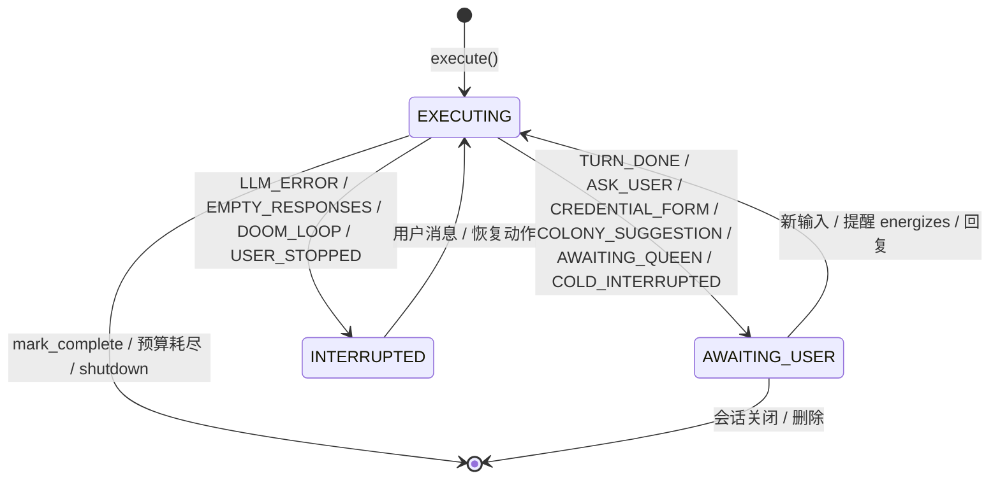

| 顶层状态 | 包含的 ParkReason | 谁来推动 |
|---|---|---|
| `AWAITING_USER` | `ASK_USER`、`CREDENTIAL_FORM`、`COLONY_SUGGESTION`、`TURN_DONE`、`AWAITING_QUEEN`、`COLD_INTERRUPTED` | 用户、前端表单、Worker 回复、定时器 |
| `INTERRUPTED` | `LLM_ERROR`、`EMPTY_RESPONSES`、`DOOM_LOOP`、`USER_STOPPED`、`UNKNOWN` | 用户消息、Sentinel/idle nudge、恢复逻辑 |
| `EXECUTING` | 无（不是停泊） | 循环自身 |

关键区分：

- `ASK_USER` / `CREDENTIAL_FORM` / `COLONY_SUGGESTION` / `AWAITING_QUEEN` 是**外部等待**，idle nudge 不打扰；
- `TURN_DONE` / `USER_STOPPED` / `COLD_INTERRUPTED` 是**静默停泊**，不自动唤醒；
- `LLM_ERROR` / `EMPTY_RESPONSES` / `DOOM_LOOP` 是**故障停泊**，用更短的 30s 预算恢复。

> 源码细节：`mark_user_stopped()` 的 docstring 说“只由真实用户消息清除”，但 `inject_event()` 对所有 `wake=True` 的注入都会执行 `self._user_stopped = False`；`is_client_input` 额外负责重置 idle nudge、通知 Sentinel、记录 pending user text。因此 Worker 报告、通道消息等非客户端注入也可能解除停止标记。做生命周期分析时，这是一个需要注意的实现与注释不完全一致之处。

### 2.2 L1：一次 `execute()` 的完整路径

```text
[创建] AgentLoop(config, tool_executor, conversation_store, on_report)
   │
   ├─ execute(ctx)
   │    ├─ restore(cursor/parts) ──有 checkpoint──► 恢复迭代号/输出/停泊/停止标记
   │    ├─ bind ReminderHub（按角色过滤源）
   │    ├─ 若无输入且不应运行 ──► _await_user_input(ParkReason)
   │    └─ _run_turn_loop
   │         ├─ 每轮：注入队列 drain → 提醒 → 流 → 工具 → judge → 预算/压缩
   │         ├─ 需要等待 ──► _await_user_input(reason) ──写 cursor──► 返回 AgentResult(parked)
   │         └─ 完成 ──► _finalize_result ──写 cursor──► 返回 AgentResult
   │
   └─ 外部 inject_event / inject_trigger ──► 唤醒或排队 ──► 再进 _run_turn_loop
```

失败分支：

| 失败 | 迁移 |
|---|---|
| LLM 流中断 | 有界重试 / 容量重试；仍失败 → `LLM_ERROR` 停泊 |
| 流停顿 | continue nudge；超过次数 → `STREAM_STALLED` 事件，转异常路径 |
| 连续空回合 | `EMPTY_RESPONSES` 停泊 |
| 工具指纹重复 | `DOOM_LOOP` 停泊或 breaker |
| 上下文超限 | 压缩 → 重试；压缩连续失败 3 次 → 停止自动压缩 |
| 用户 Stop | 取消当前流/工具 → `USER_STOPPED` 停泊，写盘 |
| 进程死亡 | 下次启动 `COLD_INTERRUPTED` 或按 pending_input 恢复 |

### 2.3 L2：单回合的决策顺序

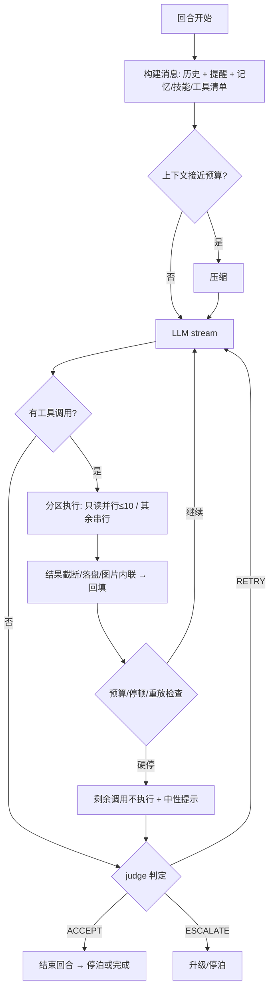

顺序不变量：

1. **先压缩再发送**：发送前保护优先于模型调用。
2. **工具结果先处理后回填**：截断/落盘发生在写入对话前。
3. **judge 在没有工具调用时才真正评估**；有工具调用默认继续。
4. **预算硬停发生在工具执行前**，不是执行后。

### 2.4 L3：Worker 状态机

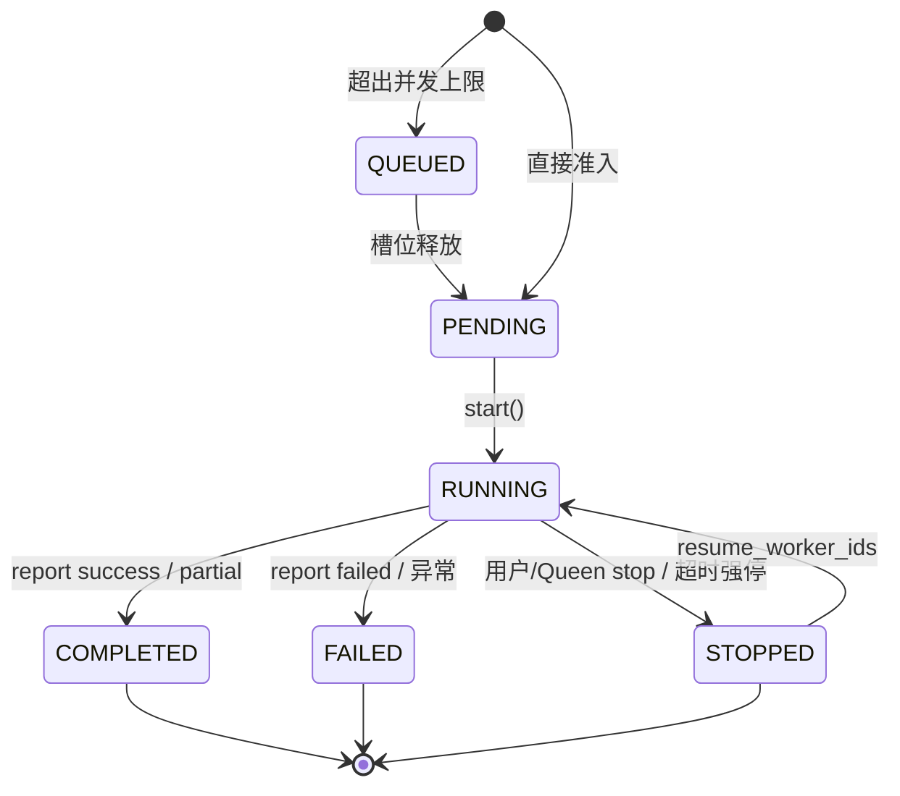

| 迁移 | 触发 | 副作用 |
|---|---|---|
| QUEUED → PENDING | 前一个 Worker 终止 | 从 `_pending_queue` 提升 |
| PENDING → RUNNING | `start()` | 建 AgentLoop/工具/绑定 |
| RUNNING → COMPLETED | `report_to_parent(success/partial)` | `SUBAGENT_REPORT` |
| RUNNING → FAILED | `report_to_parent(failed)` / 异常 | 合成报告 |
| RUNNING → STOPPED | `stop_worker` / 硬超时 | 保留对话，可恢复 |
| STOPPED → RUNNING | `run_worker(resume_worker_ids)` | 从保存对话继续 |

`WorkerResult.status` 与 `WorkerStatus` 是两套：前者是业务结果（success/partial/failed/timeout/stopped），后者是运行时状态。

### 2.5 L4/L5：Session、Queen 阶段与 Colony

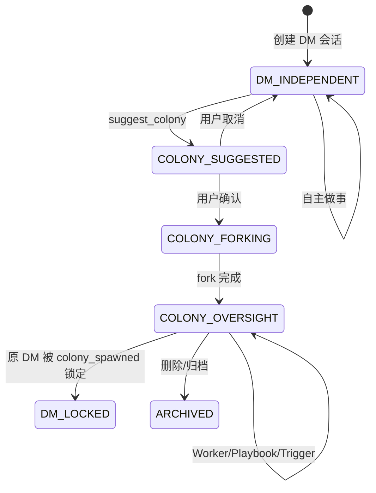

| 状态 | 判定字段 | 说明 |
|---|---|---|
| DM independent | `mode="dm"`、`phase="independent"` | 普通 Queen 聊天 |
| Colony suggested | 停泊 `COLONY_SUGGESTION` | 等用户确认，原会话不锁 |
| Colony forking | 后台压缩 + seed 复制 | `compaction_status` 标记 |
| Colony oversight | `mode="colony"`、`binding` 非空 | 有 Tracker/Worker/Trigger |
| DM locked | `colony_spawned=true` | 继续聊天需 compact-and-fork |
| Superseded | `superseded_by` | 对话已移到新 session |

关键顺序：**先复制、再压缩、再 seed，最后返回**。压缩在后台（180s 上限），会话加载时通过 `compaction_status` 等待完成；失败则回退原始 transcript。

### 2.6 L6：Trigger 状态机

```text
available（triggers.json 中定义，未激活）
   │ set_trigger（校验 cron/interval/webhook + task）
   ▼
active（timer task / webhook subscription 已建立）
   │ 到点 / 收到请求
   ▼
fired（inject_trigger；Queen 开回合）
   │
   ├─ remove_trigger ──► removed
   ├─ 会话关闭 ──► inactive（last_fired_at/next_due_at 保留）
   └─ 会话重新加载 ──► compute_missed ──► 当前实现静默跳过（把 last_fired_at 设为 now；MISSED_TRIGGERS 端点仍在但无生产者）
```

### 2.7 L7：Sentinel 升级状态机

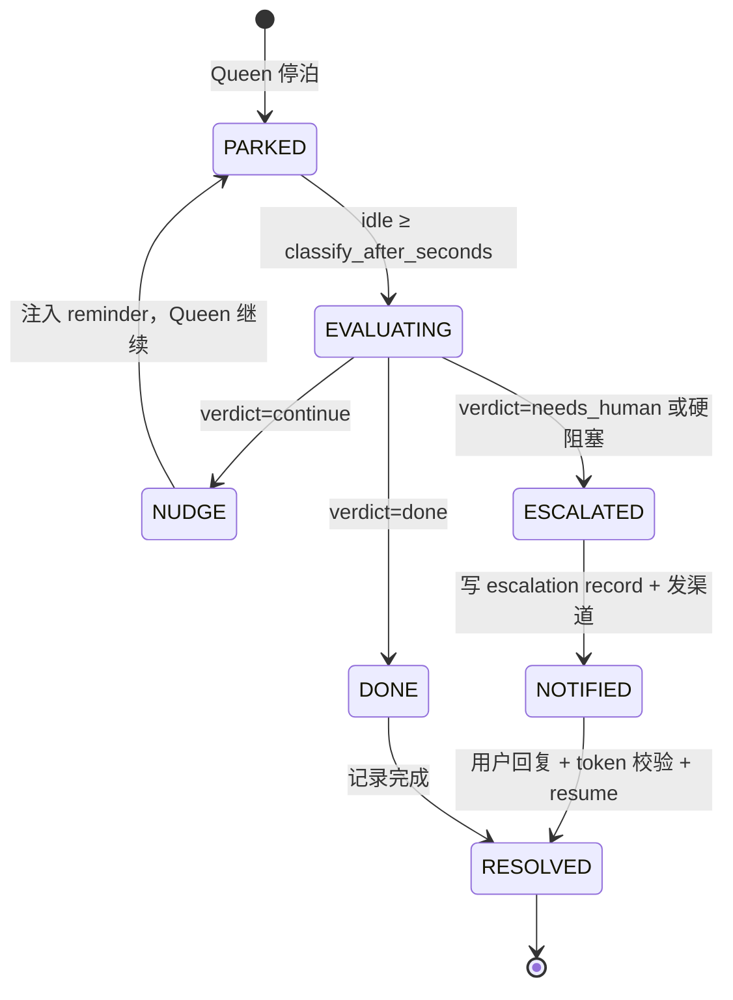

报告种类：`blocker`、`heartbeat`、`done`、`progress`；`progress` 只进 Hive Inbox feed，不发 Telegram/Slack。

### 2.8 L8：Playbook run 状态机

```text
parse/load ──失败──► failed(traceback)
   │ 成功
   ▼
快速窗口 1.5s
   ├─ 完成 ──► completed
   ├─ 失败 ──► failed
   └─ 超时 ──► started(run_id) ──后台──► converge
                                         ├─ pending 空 ──► completed
                                         ├─ max_rounds/熔断 ──► completed + deadletter
                                         ├─ stop_playbook ──► stopped
                                         └─ 异常 ──► failed
```

重启后：正在运行的循环丢失；已完成 run log 与 Tracker 保留；用 `playbook_name` 重跑即续跑。

### 2.9 L9：Skill 生命周期

```text
discover（5+ 作用域，同名后者覆盖）
  → trust gate（project scope 需同意）
  → overrides（启停/预设默认）
  → catalog（name + description）
  → 按需加载 SKILL.md
  → write_skill（colony/queen text 直接写；global 生成安装请求）
  → 热重载（SKILL.md / overrides 变更）
```

全局安装请求需要用户在会话页面批准，才会写入共享库。

### 2.10 L10：Memory note 生命周期

```text
对话回合
  → 每 6 回合 / 压缩 / 会话结束触发反思
  → write_memory_file / delete_memory_file
  → log.jsonl（before/after、作者、证据、confirmed）
  → recall（index/wait/background）
  → 用户编辑（author=owner，反思不可覆盖）
  → 退休/恢复（从 log 还原）
```

### 2.11 L11：Soul 生命周期

```text
每日 hour 后
  → 读取自上次以来的会话（按 sources/titles 过滤）
  → 提案 edits（逐字引文 + 证据数校验 + 字符上限）
  → review：等待用户批准 / auto：立即应用
  → 新版本写入 soul.json + history/
  → 回滚到任意版本
```

### 2.12 L12：Credential 生命周期

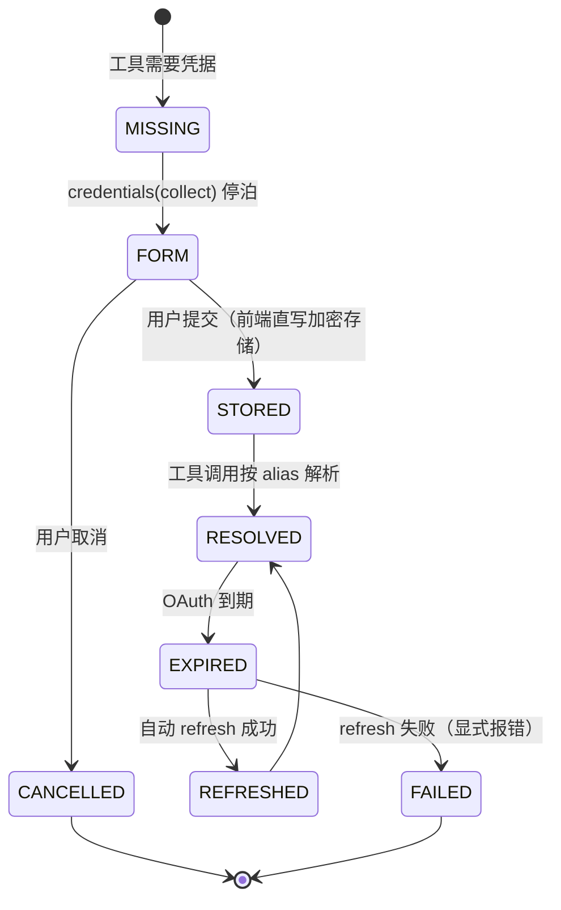

### 2.13 L13：Queen Mail 链

```text
send(message)
  → 日限额检查（daily_limit）
  → depth = cause.depth + 1；超过 max_depth → 拒绝/丢弃
  → 目标 Queen 的固定会话投递
  → 对方回复（depth 继续 +1）
  → 用户/定时器/Worker 报告出现 → 链重置
  → 每跳写 mail.jsonl
```

---

## 3. 关键交互序列

> 图中 `FE` 前端、`API` aiohttp、`SM` SessionManager、`QO` QueenOrchestrator、`AL` AgentLoop、`EB` EventBus、`LLM` 模型、`TR` ToolRegistry、`CR` ColonyRuntime、`W` Worker、`DB` 磁盘/SQLite。

### S1：Dashboard 发一条消息

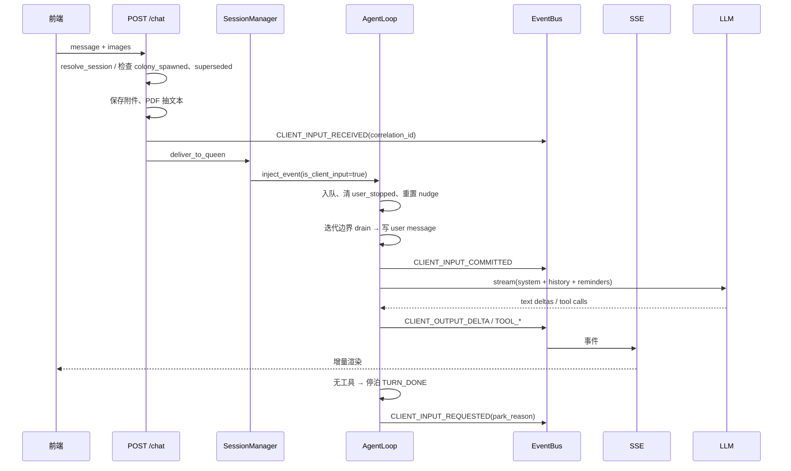

失败分支：

- 会话已建群/已被取代 → 409 `session_locked`；
- Queen 启动中 → 等待最多 5s；仍不可用 → 503；
- 附件无法解析 → 文本降级/提示，消息仍可发送。

### S2：工具执行期间用户再发一条消息

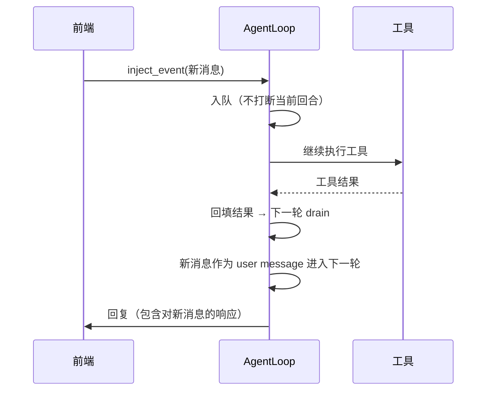

顺序保证：新消息不会插到工具结果之前；它在**下一轮模型调用前**进入上下文。`CLIENT_INPUT_COMMITTED` 的 seq 是真实注入点，前端据此重排气泡。

### S3：一个回合内的工具批

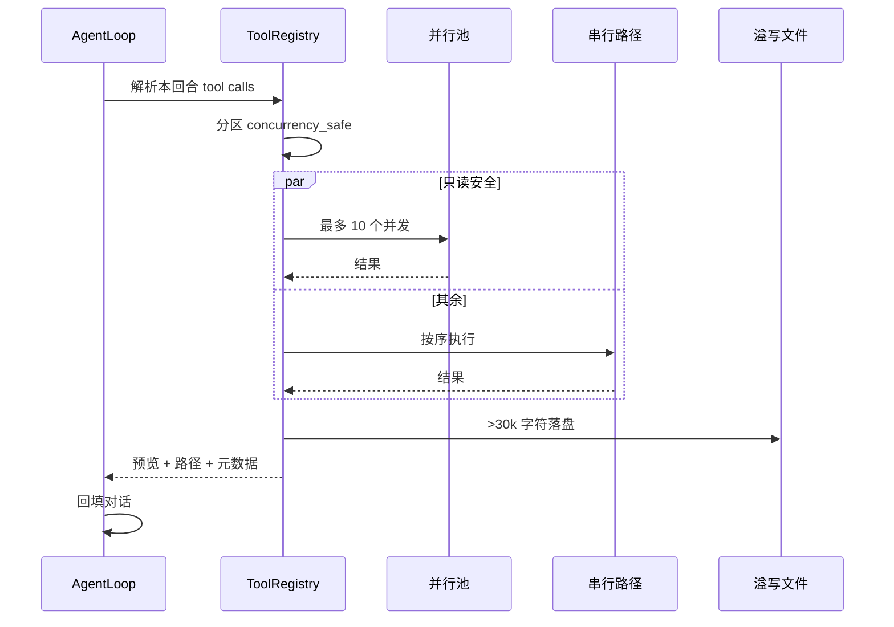

超时/后台分支：

- 单调用 >60s（browser 180s）→ 超时错误结果；
- `image_generate` / `terminal_exec` >5s → 返回 handle，后续 `collect_result`；
- MCP 调用受 240s 上限约束。

### S4：`run_worker` 扇出与报告

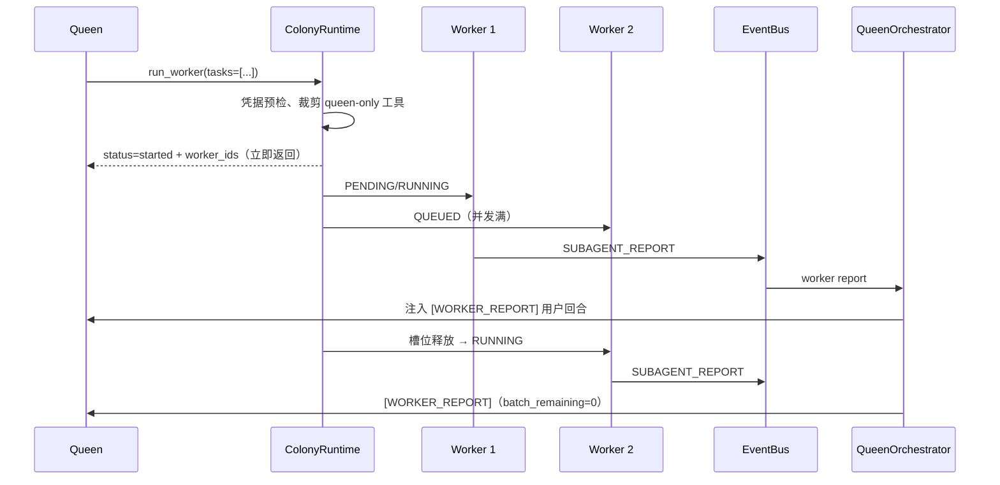

关键点：`run_worker` 立即返回；报告是**新回合**，不是同步返回值；`batch_remaining` 包含 queued + running。

### S5：Worker 软超时、硬超时与恢复

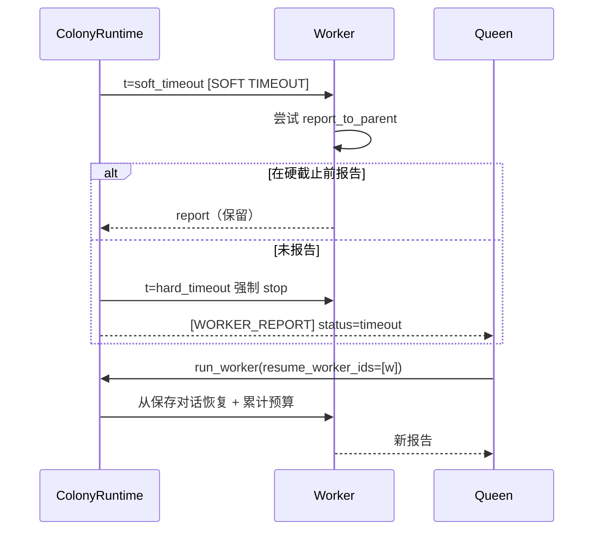

硬截止公式：`max(4×soft, soft+600)`，上限 3600s。

### S6：从聊天创建 Colony

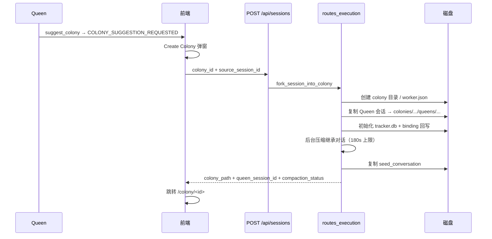

失败分支：压缩失败/超时 → 保留原始 transcript，Colony 仍可打开；fork 失败 → 原 DM 不锁。

### S7：Playbook 收敛

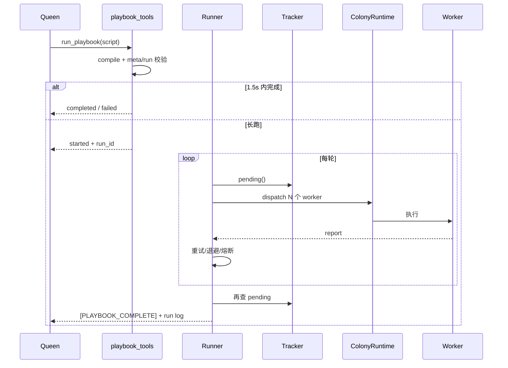

未解决行进入 `deadletter`；重跑时 done 行不再出现。

### S8：Sentinel 升级与回复

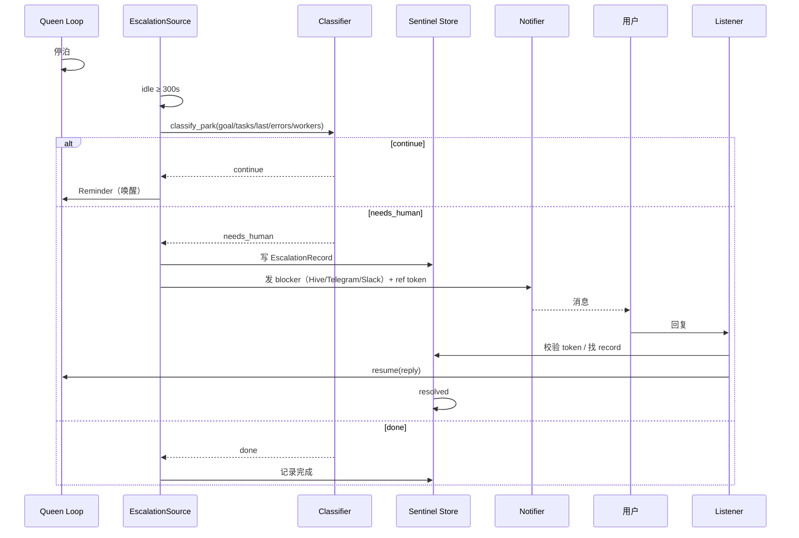

### S9：Channel 消息

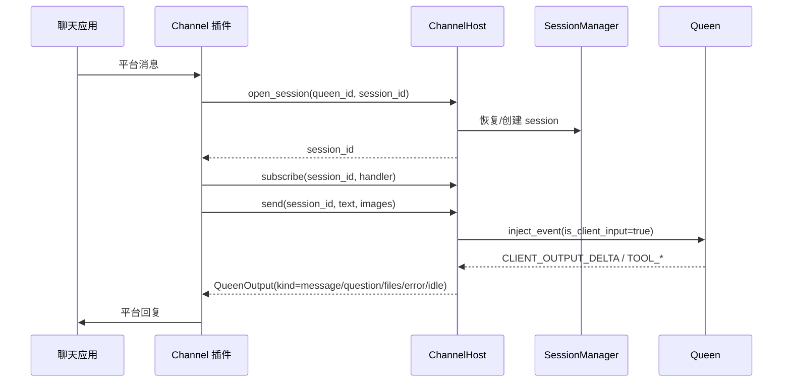

输出是**至多一次**：handler 异常只记日志，不重放。

### S10：Trigger 触发与错过补偿

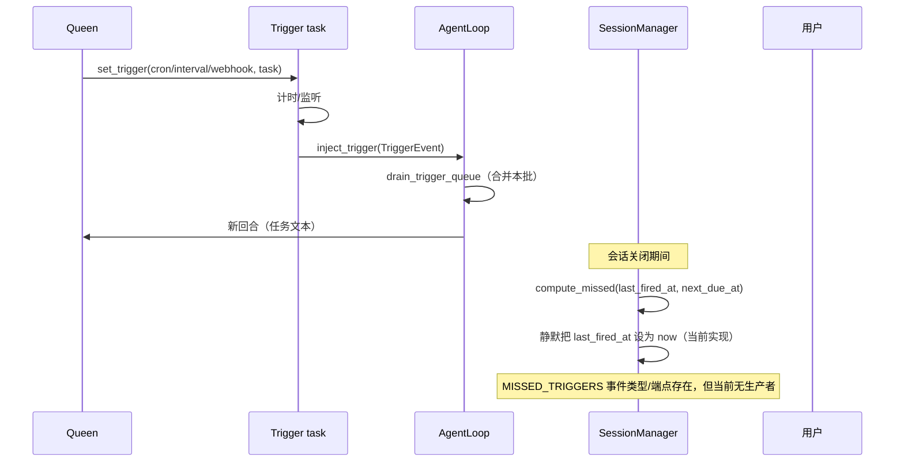

触发器只在会话被加载时运行；当前实现会静默跳过错过的 tick，不自动补跑。

### S11：记忆反思与召回

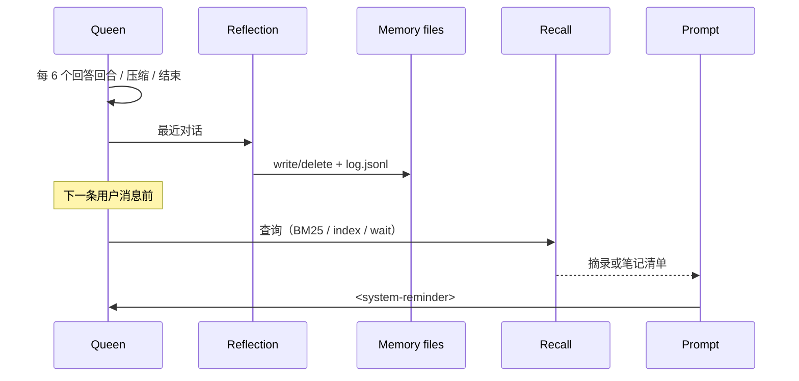

### S12：凭据收集

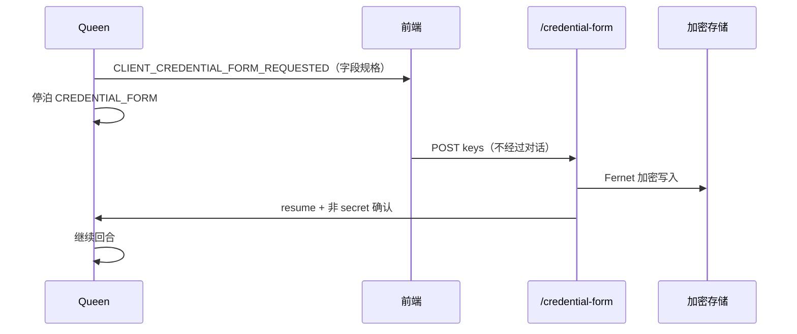

取消也走 resume，但只注入“用户取消”的说明。

### S13：上下文压缩

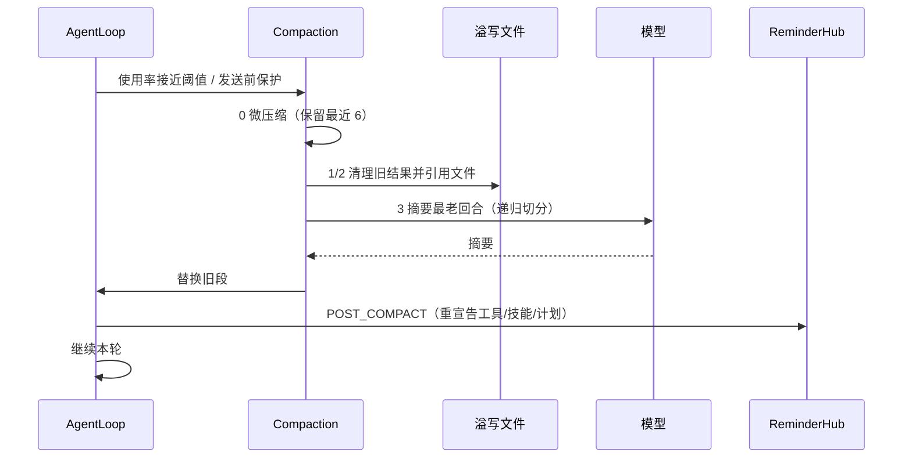

失败：连续 3 次压缩失败 → 停止自动压缩；超长用户消息先截断。

### S14：崩溃恢复

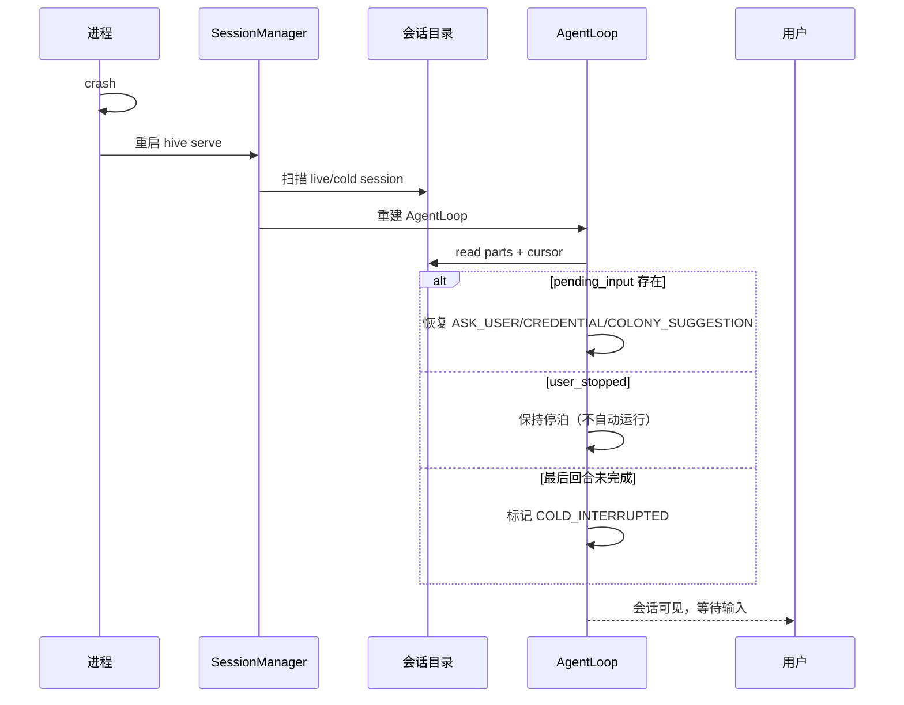

### S15：Queen Mail

```mermaid
sequenceDiagram
    participant A as Queen A
    participant M as QueenMail
    participant B as Queen B
    participant L as mail.jsonl
    A->>M: message_queen(B, text)
    M->>M: daily_limit / depth 检查
    M->>B: 投递到固定会话 [A(queen_a)]
    M->>L: 记录 hop
    B->>B: 处理
    B->>M: 回复
    M->>M: depth+1 检查
    M->>A: 回到 A 的会话
    M->>L: 记录 reply
```

用户消息、触发器、Worker 报告会重置链深度。

---

## 4. 失败与超时矩阵

| 场景 | 检测点 | 第一动作 | 最终状态 |
|---|---|---|---|
| LLM 瞬时错误 | 流/调用异常 | 有界重试（5 次） | 成功或 `LLM_ERROR` |
| 429/529/overloaded | 容量错误 | 持续重试至 600s | 成功或 `LLM_ERROR` |
| 上下文超限 | provider 错误 | 压缩后重试 | 成功或失败停泊 |
| 流停顿 | TTFT 600s / 事件间 120s | continue nudge（≤3） | 恢复或 `STREAM_STALLED` |
| 会话空闲 | 120s / 30s | idle nudge | 继续或等待 |
| 工具超时 | 60s/180s | 超时结果回填 | 模型决定重试/换法 |
| 工具死循环 | 3 次相同指纹 | breaker | 停泊/结束 |
| 文本重复 | 3 次相似 ≥0.85 | stalled | 停泊/结束 |
| Worker 软超时 | `run_worker.timeout` | `[SOFT TIMEOUT]` | 报告或被强停 |
| Worker 硬超时 | `max(4×soft, soft+600)` | 强停 | `timeout` 报告 |
| 压缩失败 | LLM 异常 | 重试 / 降级 | 3 次后停止自动压缩 |
| Playbook 失败 | load/run/worker | failed / deadletter | 可重跑 |
| Sentinel 分类失败 | LLM 异常 | 保守 `continue`（errored） | 不误升级 |
| Channel handler 异常 | 投递协程 | 记日志 | 该输出丢失 |
| 进程崩溃 | 重启 | parts/cursor 恢复 | `COLD_INTERRUPTED`/pending |
| 凭据刷新失败 | resolve | 显式 `CredentialExpired` | 工具失败，提示用户 |

---

## 5. 顺序不变量（跨序列）

1. **单写者**：外部消息只入队；对话写入由 AgentLoop 在迭代边界完成。
2. **先事件后注入**：`CLIENT_INPUT_RECEIVED` 在 `inject_event` 前发布，保证记忆召回等 handler 先完成。
3. **先复制后压缩**：Colony fork 先 `copytree`，再后台压缩；失败仍有原始 transcript。
4. **先注册后派发**：Playbook 的 `concurrent`/lane 限制在 dispatch 前生效；Colony 的 binding 在 spawn 前写入 `input_data`。
5. **seq 单调**：EventBus 的 `seq` 是去重与排序的锚点；`CLIENT_INPUT_COMMITTED` 修正用户气泡位置。
6. **token 不可伪造**：Sentinel 回复必须通过 HMAC token 校验才进入 resume。
7. **预算先于执行**：工具硬停/生命周期预算在调用前判断，避免“先花钱再报错”。
8. **锁优先**：`colony_spawned` / `superseded_by` 在消息进入前检查，前端锁定只是 UX，服务端强制。

---

## 6. 仍不可从源码完全分析的部分

- **模型内部决策**：为什么选择某个工具、是否遵从提醒，属于模型行为；本章只能给出框架的输入与约束。
- **真实网络时序**：MCP 子进程启动、浏览器桥重连、Telegram/Slack 轮询的实际延迟，依赖部署环境。
- **前端渲染时序**：SSE 到达顺序有 seq 保证，但 React 批处理/动画不在本报告范围。
- **闭源可选包**：`framework.crm` / `framework.cloud_sync` 不在本工作区，相关序列只描述接口与降级。

---

## 7. 与前面章节的对应

| 本章 | 深入阅读 |
|---|---|
| L1/L2、S1–S3、S13–S14 | 03 执行内核 |
| L3/L5、S4–S6 | 04 Colony/Queen/Worker |
| L4、S1/S6 | 05 状态、11 Server |
| L10/L11、S11 | 06 记忆与 Soul |
| L9、S7 | 07 技能与 Playbook |
| L6/L7/L13、S8/S10/S15 | 08 自治与入口 |
| L12、S12 | 10 模型与凭据 |
| L8、S7 | 07 / 11 |
| 失败矩阵 | 03 / 04 / 12 |
